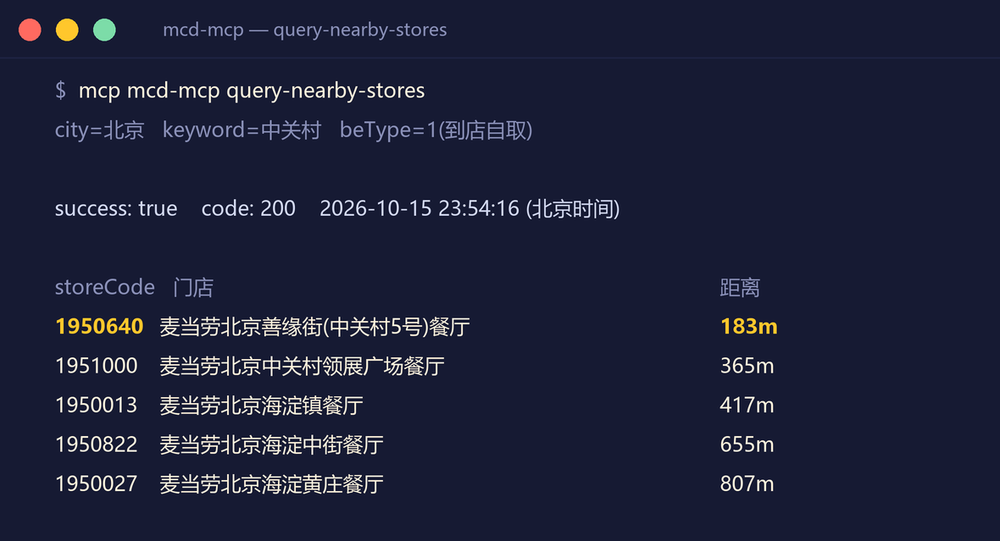
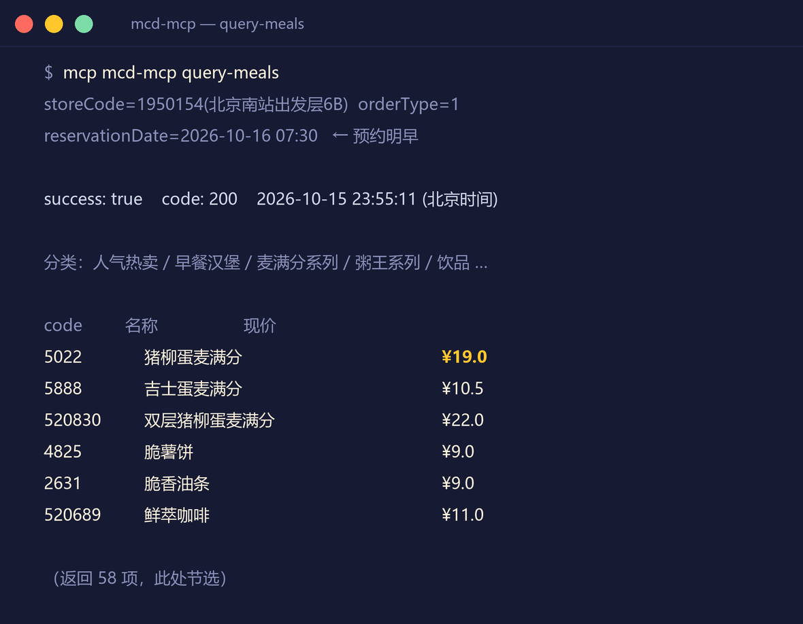
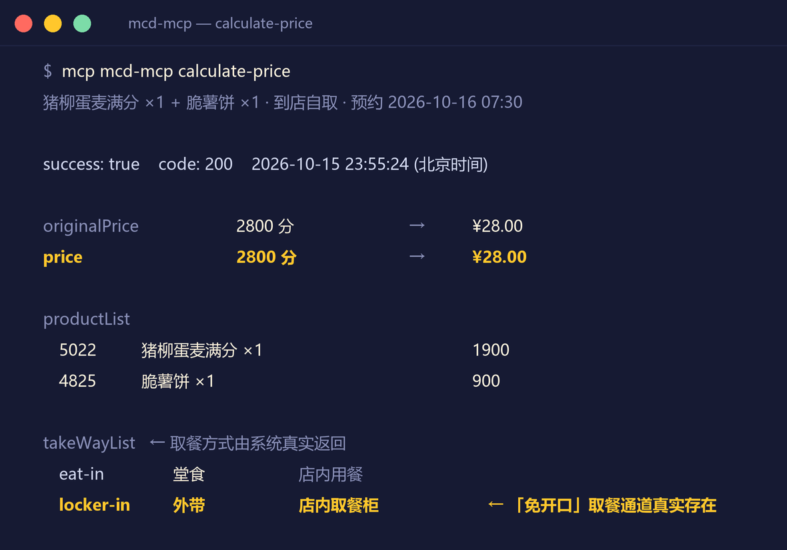
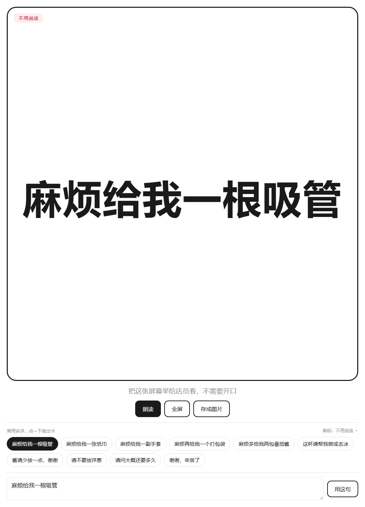

<div align="center">


# 麦麦免开口 · mcd-quiet-order

**一个基于麦当劳中国 MCP Server 的静默点餐 Skill。**
**从下单到取餐，不用跟任何人说一句话。**


[这是什么](#-这是什么) · [60 秒看懂](#-60-秒看懂) · [先跑一遍](#-不用-token-先跑一遍) · [安装](#-安装)

**为不好意思开口的人、说不出来的人、不想接电话的人。**

</div>

---

## 👋 这是什么

先做个自测。下面这几句话，你说过哪几句？

> ① 「算了，不点了。」—— 因为要跟骑手说「放门口」。
> ② 「算了，不加了。」—— 因为想加一副手套，得喊住已经走远的店员。
> ③ 「算了，不要了。」—— 因为想问一句「这个辣不辣」，队伍在后面排着。

**中两条，这个 Skill 就是为你做的。** 一条都没中？也欢迎——你就当它是个帮你把券算明白的搭子。

点餐这个动作本身，如今已经可以不用开口完成。难的是它的前后两段：

- **点餐之前**：券和活动看不懂、算不清；
- **点餐之后**：付完款才想起还想要一副手套、一张纸巾。这类诉求都发生在「交易之后」，不属于任何订单系统的表达范围，所以常常只能忍着。

「麦麦免开口」把整条链路接起来：


---

## ⚡ 60 秒看懂

| 能力 | 一句话 | 背后的 MCP 能力 |
|---|---|---|
| 🧠 **A · 记住你的习惯** | 说一次，之后每次自动带入，下单前逐条复述 | `order-list` + 本地档案 |
| 🤫 **B · 静默下单** | 备注写「放门口」、可乐去冰、要餐具——让订单替你说话 | `create-order` |
| 📱 **C · 沟通卡** | 「麻烦给我一根吸管」全屏大字，举给店员看，还能朗读 | 本地脚本自动弹出 |
| 💰 **D · 算最省** | 逐券真实核价，直接给实付最低的方案 | `calculate-price` |

四个能力里，**A 是别的工具替代不了的那个**。写备注、勾餐具、选券，你自己动手也都能做到——**但没有人能每次都记得住**。把习惯记下来，一次说清，之后不用再说，这才是它和你自己打开 App 的区别。

### 能力 A 长什么样

**给自己点**：不用配置。它读你的历史订单，把看出来说给你听：

> 「看你最近几单都是巨无霸套餐配无糖可乐，要不要记成『老样子』？
> 另外——外卖是不是每次都放门口？这条**历史订单里看不到，得你说一次**我才记得住。」

它还能按门店分开记：公司楼下是一个吃法，家附近是另一个吃法，各自有各自的习惯。

**首次使用，只会被问两件事**（一次问完，之后不再重复）：有什么忌口；外卖是不是每次都放门口、餐具要不要固定。其余一切从历史订单里自己看。

**给别人点**：问三个问题就够了（忌口 / 送到哪 / 有没有别的习惯），存成对方的档案。下次再说「帮我妈点」，直接读档案，只确认一句。

> 🔍 **它不会装懂**：每条偏好都标注来源（历史推断的 / 你亲口说的 / 手动设的）；「从没点过辣的」不会推出「不吃辣」；忌口与过敏必须你亲口确认。档案只存本机，不上传，随时可看可删。

### 能力 B · C · D 的细节

**静默下单** 三种场景全覆盖：

| 场景 | 零沟通链路 |
|---|---|
| 🛵 麦乐送 | 诉求写进 50 字备注 → 无接触配送 → 不见骑手 |
| 🏪 到店自取 | 特制与餐具写进订单 → **取餐柜二维码**扫码自取 → 不见店员 |
| 🚗 得来速 | 车道上不说话完成取餐 |

**沟通卡** 管剩下的事：到店没有备注通道，吸管、纸巾这类诉求在订单里也没有字段，只能靠它。常用诉求已经做成一键剧本，点一下就出，不用自己组织语言。角落有一句自嘲式角标（「不用说话」「i人友好」）——举手机的时候看起来像开玩笑，比看起来像出示证明，更容易举得起来。

**算最省** 采用「本地穷举 + MCP 核价」：组合搜索在本地完成（绕开限流），只有最终的几个方案交给 `calculate-price` 真实计价——你看到的每一个金额都是麦当劳系统算出来的，不是估的。

---

## 🎬 不用 Token，先跑一遍

仓库自带一个**全流程模拟**：不联网、不调用 MCP、不下单、不动真实档案，把从「开口」到「取餐」的完整过程走给你看。

```bash
cd mcd-quiet-order/scripts
python demo.py
```

真实输出（节选）：

```text
━━━━━━━━━━━━━━━━━━━━━━━━━━━━━━━━━━━━━━━━━━
  第 1 步 · 偏好层 · 给自己点（从历史订单推断）
━━━━━━━━━━━━━━━━━━━━━━━━━━━━━━━━━━━━━━━━━━

  用户 │ 帮我点个麦当劳
  麦麦 │ 先看看你的档案——还是空的。读一遍历史订单：
       │  · 麦当劳（软件园店）（1990622）：4 单
       │  · 麦当劳（火车站店）（3001888）：2 单
  麦麦 │ 你说「看软件园这家」——历史自带门店信息，本地筛一下就行：
       │  · 常点是「巨无霸套餐（中薯条、无糖可乐(中)）」—— 最近 4 单全是它
       │  · 习惯的取餐方式：到店自取
       │  · 常在 12 点前后下单
  麦麦 │ 还有件事必须说实话：历史订单里没有备注和特制字段，
       │ 所以放门口、去冰这些，历史里看不出来。这次怎么点？
  用户 │ 这次外卖，放门口别敲门，餐具要一副

  （档案写入后：）
  档案：我自己 [self] （当前）
    外送备注      无接触配送，请放门口，不用敲门（下单前问到的）
    需要餐具      是（下单前问到的）
    偏好方式      麦乐送（下单前问到的）
    口味偏好      无糖可乐（从历史订单推断）
```

到最后一步它会停下来——**真实运行时，只有在第 4 步你亲口确认之后才会真正下单**，付款也永远由你自己扫码完成。

也可以单独玩每个部件：

```bash
# 偏好档案：说一次，之后自动带入（每条偏好都会标注来源）
python preference_store.py set --json '{"remark": "无接触配送，请放门口"}' --source asked
python preference_store.py new mom --label "我妈"
python preference_store.py list

# 优惠试算：本地穷举，只把前几名交给 MCP 核价
python best_coupon_calc.py plan \
  --menu sample_data/menu.json \
  --coupons sample_data/coupons.json \
  --request sample_data/request.json
python best_coupon_calc.py verify --results sample_data/results.json --format text
```

```text
商品：巨无霸套餐 ×1 + 麦乐鸡5块 ×1
门店：麦当劳（软件园店）（到店自取 · 取餐柜）
原价：¥55.00

方案对照：
  A  满 40 减 10 + 满 20 送香芋派  实付 ¥45.00   ← 推荐
  B  小食 8 折                     实付 ¥52.40
  C  不使用优惠券                  实付 ¥55.00

推荐方案 满 40 减 10 + 满 20 送香芋派，可省 ¥10.00（约 18%）。
```

它还会顺手把另一条路也算出来：同一单改麦乐送，到手 ¥54.00（含配送费 ¥9.00），比自取贵 ¥9.00——正好是一单配送费。省不省这 9 块是你的事，但这个数应该摆在你面前。

> 示例金额为演示数据；真实场景下所有金额均来自 MCP `calculate-price` 的核价。

沟通卡也不用你自己去开网页——需要的时候它会直接弹出来：

```bash
python mcd-quiet-order/scripts/quiet_card.py --preset 吸管
```

十条常用剧本一键出卡（吸管 / 纸巾 / 手套 / 打包袋 / 番茄酱 / 去冰 / 少放酱 / 不要洋葱 / 催单 / 道谢），全屏大字、点击朗读、导出图片。脚本也可以自己拿去用，比如 `--tag i人友好` 换个角标。

---

## 📸 真实运行截图

以下均为**真实 MCP 调用**的返回（采集于 2026-10-15，北京地区门店，预约场景）。
截图只到价格计算为止——再往下一步就会产生真实订单，不适合拿来演示。

| 真实门店查询 | 真实菜单（预约明早 7:30） | 真实核价 |
|:---:|:---:|:---:|
|  |  |  |

顺带说一个开发时的发现：上面的核价返回里，`locker-in（外带 · 店内取餐柜）` 是接口原样给出来的取餐方式。也就是说，「不说话取餐」这条路在麦当劳系统里一直存在；这个 Skill 做的，只是把它用到了需要它的人身上。

沟通卡的真实页面（浏览器直接打开，无需任何配置）：

<p align="center"></p>

---

### ⚡ 懒人通道：把这段话发给你的 Agent

不想自己一步步配？**把下面整段复制，发给你正在用的 AI Agent**（WorkBuddy、Cursor、Cherry Studio 都行），它会带着你走完全程。发之前只需替换两个 `<>` 占位。

```text
请帮我部署一个开源 Skill，仓库地址：<在此粘贴本仓库的 GitHub 地址>

按下面五步来做，每完成一步先告诉我结果，再进下一步：

1. 先读懂它。读仓库根目录的 README.md、MCP_INTEGRATION.md，以及
   mcd-quiet-order/SKILL.md。用三句话告诉我：它解决什么问题、需要什么前置条件、
   有哪些安全边界。

2. 带我配置麦当劳中国 MCP。引导我打开 https://open.mcd.cn/mcp，手机号登录，
   在右上角「控制台」点激活并复制 MCP Token。然后明确告诉我这段 JSON 该写进
   我当前客户端（<这里写你用的客户端，例如 Cursor / Cherry Studio / WorkBuddy>）
   的哪个页面或哪个配置文件：

   {
     "mcpServers": {
       "mcd-mcp": {
         "type": "streamablehttp",
         "url": "https://mcp.mcd.cn",
         "headers": { "Authorization": "Bearer YOUR_MCP_TOKEN" }
       }
     }
   }

   提醒我：Authorization 必须保留 "Bearer " 前缀和那个空格；真实 Token 不要提交到
   任何公开仓库。

3. 验证连通。配置完成后发一次 MCP initialize 请求确认能连上。报 401 通常是漏了
   "Bearer " 前缀；报 429 是触发了 600 次/分钟的限流，需要放慢频率。

4. 安装 Skill 并自检。把 mcd-quiet-order/ 整个目录复制到技能目录（WorkBuddy 用户是
   ~/.workbuddy/skills/；其他客户端请按你的规则放到等价位置）。然后在不需要 Token 的
   情况下运行 python mcd-quiet-order/scripts/demo.py，把它的输出讲给我听，让我知道
   它到底会怎么帮我点餐。

5. 先别下单。装好后只告诉我一句话：我平时怎么说就能触发它。在我明确同意之前，
   不要真的创建订单。

另外：凡是需要我本人操作或授权的地方（申请 Token、付款、写入偏好档案），都要先问我，
不要替我跳过确认。
```

---

### 或者，自己动手（三步）

#### 第一步：配置麦当劳 MCP（任意 MCP 客户端通用）

配置方法与[麦当劳官方文档](https://github.com/M-China/mcd-mcp-server)完全一致——任何支持 **Streamable HTTP** 的 MCP 客户端（WorkBuddy、Cherry Studio、Cursor、Kiro、Trae、VSCode 等）都可以接，不限于某一家。

1. 访问 <https://open.mcd.cn/mcp> → 手机号登录 → 右上角「控制台」→ 点【激活】申请并复制 MCP Token；
2. 把下面的配置粘进你所用 MCP 客户端的 Server 配置中，替换 `YOUR_MCP_TOKEN`（JSON 原样取自官方仓库）：

```json
{
  "mcpServers": {
    "mcd-mcp": {
      "type": "streamablehttp",
      "url": "https://mcp.mcd.cn",
      "headers": {
        "Authorization": "Bearer YOUR_MCP_TOKEN"
      }
    }
  }
}
```

> ⚠️ **保留 `Bearer ` 前缀（含空格）**——缺少前缀会返回 401，客户端界面通常表现为「需要认证」且点击连接无响应。
> 官方注意事项：每个 Token 每分钟最多 600 次请求（超出返回 429）；请妥善保管 Token，避免泄露；**切勿将真实 Token 提交到任何公开仓库**。
> 各客户端的分平台图文教程，直接看官方仓库 → <https://github.com/M-China/mcd-mcp-server>

<details>
<summary>📂 常见客户端的配置入口（点开查看）</summary>

| 客户端 | 配置入口 |
|---|---|
| **WorkBuddy** | 【专家·技能·连接器】→【连接器】→【自定义连接器】→【配置 MCP】 |
| **Cherry Studio** | 设置 → MCP → 添加 → 「从 JSON 导入」→ 粘贴上面的 JSON |
| **Cursor** | 设置 → Tools & MCP → Add Custom MCP → 编辑 `mcp.json` |
| **Trae** | 设置 → MCP → 手动添加 → 粘贴 JSON → 对话框选「Builder with MCP」 |
| **Kiro** | 按 [Kiro MCP 文档](https://kiro.dev/docs/mcp/) 配置 |
| **VSCode (Copilot)** | 按 [VSCode MCP 文档](https://code.visualstudio.com/docs/copilot/customization/mcp-servers) 配置 |

</details>

#### 第二步：安装本 Skill

```bash
# 用户级（推荐）
cp -r mcd-quiet-order ~/.workbuddy/skills/

# 或项目级
cp -r mcd-quiet-order .workbuddy/skills/
```

#### 第三步：像平时点单那样说话

重启对话后，**正常说你要点什么就行**——「帮我点个麦当劳」「点份外卖」「来份麦乐送」都能触发，不需要任何特殊指令。带上这些信息时它会做得更好：

- 「放门口 / 不用敲门 / 不想接电话」→ 自动写进外送备注；
- 「可乐去冰 / 少放酱」→ 走订单特制；
- 「不好意思要吸管 / 帮我妈点一份」→ 出沟通卡 / 建对方档案。

不想开口这个事，不用说出口它也会尽量照办；说了，它一定照办。

<details>
<summary>🤖 给 Agent 看的安装与使用说明（如果你是 AI agent，读这里）</summary>

**你是 AI agent，正在帮用户部署或使用本 Skill。按以下步骤执行：**

**安装与自检**

1. 确认宿主环境已配置 `mcd-mcp`（Streamable HTTP，`https://mcp.mcd.cn`，请求头 `Authorization: Bearer <token>`）。最常见的故障是 **缺 `Bearer ` 前缀导致 401**；其次是 429 限流（600 次/分钟），遇 429 应串行降频。
2. 配置后发一次 MCP `initialize` 请求验证连通性；若宿主客户端有连接开关，提示用户开启并重连。
3. 将 `mcd-quiet-order/` 整个目录复制到 Skill 目录（用户级 `~/.workbuddy/skills/` 或项目级 `.workbuddy/skills/`）。
4. 无 Token 环境下，运行 `python mcd-quiet-order/scripts/demo.py` 做链路自检（不联网、不下单）；偏好档案脚本可用 `MCD_QUIET_ORDER_HOME` 指向临时目录试跑。

**使用约束（完整版见 `mcd-quiet-order/SKILL.md`，以其为准）**

- 触发条件：用户表达点餐意图（点单/外卖/到店取餐/问优惠/帮他人点餐），或表达沟通不便诉求（不想说话、不好意思开口、听障、帮长辈点）。
- 下单前必须向用户复述完整确认单（商品/门店/方式/备注/金额，单列「按你的习惯带入」段），**确认后才能调 `create-order`**；支付链接交给用户本人完成。
- 偏好写入用 `scripts/preference_store.py`，必须带 `--source inferred/asked/manual` 标注来源，写入后复述并征得同意；历史订单（`order-list`）**不含备注/特制/餐具字段**，这些只能问用户，不得推断。
- 禁止：调用 `mall-create-order` / `party-order-create` / `draw-lottery` / `delivery-create-address`；读取或输出 Token；抓取第三方平台数据。

</details>

---

## 📁 目录结构

```
.
├── README.md                      # 本文件
├── CONTEST_DECLARATION.md         # 参赛声明（赛事要求，内容不可修改）
├── MCP_INTEGRATION.md             # MCP 集成说明（赛事要求）
├── mcp-config.example.json        # 脱敏 MCP 配置示例（赛事要求，仅环境变量占位符）
├── THIRD_PARTY_NOTICES.md         # 第三方资源与许可说明
├── LICENSE                        # MIT
├── workbuddy.md                   # WorkBuddy 开发对话上下文（用于积分核验）
└── mcd-quiet-order/               # Skill 本体
    ├── SKILL.md                   # 技能定义与五条工作流
    ├── references/
    │   ├── mcp-tools.md           # MCP 工具速查与易错参数规则
    │   └── coupon-strategy.md     # 优惠试算策略
    ├── scripts/
    │   ├── demo.py                # 全流程模拟演示（不联网 / 不下单）
    │   ├── preference_store.py    # 点餐偏好本地档案（能力 A）
    │   ├── best_coupon_calc.py    # 优惠组合优化器（本地穷举 + MCP 核价）
    │   ├── quiet_card.py          # 沟通卡唤起（生成带参链接并直接打开）
    │   └── sample_data/           # 示例数据，无需 Token 即可运行
    └── assets/
        ├── quiet-card.html        # 零开口沟通卡（展示 / 朗读 / 存图）
        ├── cover.png              # 项目封面
        └── real/                  # 真实 MCP 调用截图（见「真实运行截图」章节）
```

---

## 🛡️ 安全边界

能力上刻意收窄，责任边界才清晰：

1. **下单但不代付**——`create-order` 只生成订单与支付链接，**付款始终由用户本人扫码完成**；Skill 不接触任何支付凭证。
2. **下单必须经用户明确确认**——商品、门店、取餐方式、备注内容全部确认后才提交订单。
3. **只用麦当劳官方数据**——不获取任何第三方平台的团购券或价格信息；此类数据不在麦当劳 MCP 的能力范围内。
4. **不读取、不存储、不输出 MCP Token**。
5. **不碰商城与预约类写操作**——不调用 `mall-create-order`、`party-order-create`、`draw-lottery`。
6. **偏好档案只存本机**——不上传、不联网；未经用户同意不记录；每条偏好标注来源，随时可改可删。

---

## 🧭 设计取舍

这个 Skill 只做一件事：**能写进订单的话，写进订单；写不进去的，出卡片。**

- 去冰、少酱、要餐具 → 订单特制与餐具开关；
- 取餐 → 取餐柜二维码；
- 临时想要一根吸管 → 沟通卡。

范围是故意收这么小的。只要流程里还剩一环要开口，前面做得再顺，用户最后还是得说话。所以宁可少管几件事，也要保证管到的事真的能全程不开口。

---

## 🧱 技术栈

- 运行环境：WorkBuddy Skill（Markdown 指令 + Python 脚本 + HTML 模板）
- 数据来源：麦当劳中国 MCP Server（Streamable HTTP）
- 无第三方依赖、无自建后端、无数据留存

---

## 📄 免责声明

本项目为「麦当劳程序员节创意开发大赛」参赛作品，由参赛者独立开发，**非麦当劳官方产品**。
餐品信息、价格与优惠结果均来自麦当劳 MCP 的实时返回，仅供参考，**一切以麦当劳官方渠道的实时结果为准**。
本项目不构成医疗、营养或其他专业建议。

## 📃 License

[MIT](LICENSE) · 封面插画由 AI 生成
